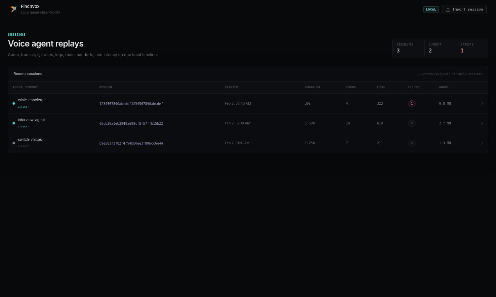
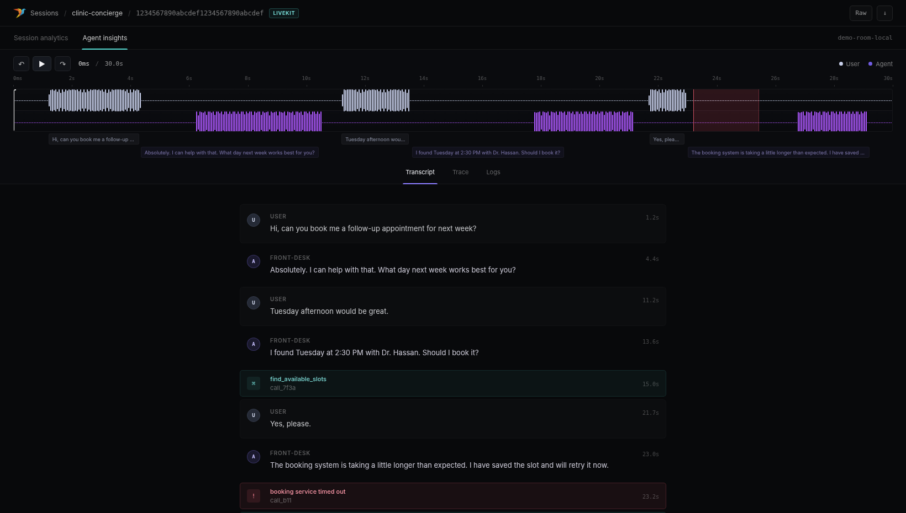
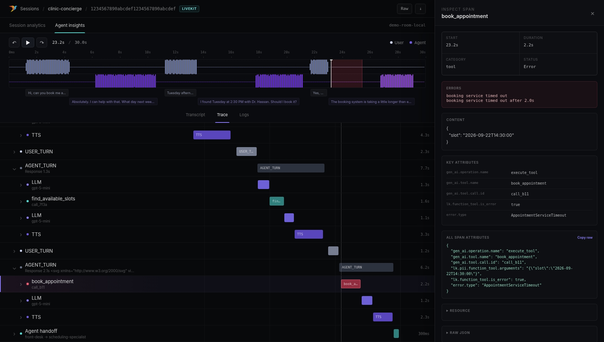

#  Finchvox — local session replay for LiveKit Agents

Finchvox is a local-first voice-agent debugger built around a simple idea: **audio, transcript, traces, logs, tools, handoffs, errors, and latency metrics should all share one session clock**.

This fork makes the LiveKit Agents integration first-class while retaining the original Pipecat support. It is designed for the same debugging workflow you get from a purpose-built agent-insights UI, but with the collector, data, and UI running on your machine.

> Independent project: this fork is not affiliated with or endorsed by LiveKit. It does not ship LiveKit branding or proprietary assets. Finchvox is MIT licensed; see [`LICENSE`](LICENSE).

## What Finchvox is, and what it is not

Finchvox is an observability and tracing tool for one call at a time. It answers "what happened in this call, and why?" by replaying the call's audio, transcript, traces, logs and metrics on one timeline.

It is not a monitoring service. It sends no alerts, runs no uptime checks, and shows no trends across many calls over days. For that, add a monitoring tool such as Grafana or Datadog, fed with the agent's metrics.

| Idea | Question it answers | Finchvox |
|---|---|---|
| Monitoring | Is something wrong right now? | No |
| Observability | Why did this call behave this way? | Yes, per call |
| Tracing | What path did this one call take, step by step? | Yes, the trace tree of each call |

Finchvox also does not watch LiveKit server traffic. The agent sends Finchvox its own traces, logs, report and recording, so Finchvox sees only what the agent reports.

## UI

### Sessions



### Transcript + synchronized replay



### Hierarchical trace waterfall + inspector



## What this fork adds

- A two-line LiveKit Agents hookup: `init_livekit()` for traces and logs, and `on_session_end` for LiveKit's `SessionReport` and the call recording.
- Support for the telemetry LiveKit Agents 1.8.9+ writes, including `lk.pii.*` content attributes.
- A synchronized **Transcript / Trace / Logs** view, plus **Metrics** and **Environment** views.
- A trace tree of sessions, user and agent turns, STT, LLM, TTS, tools, handoffs and errors. Wrapper and lifecycle spans are hidden until you choose **Show all spans**.
- One playhead and time-aligned error and event markers across the waveform, transcript and trace.
- Inspectors for spans and logs: timing, errors, content, attributes and raw data.
- LiveKit voice metrics when the SDK emits them: end-to-end latency, transcription and end-of-turn delays, queue wait, LLM time to first token, TTS time to first byte, blocked event loops, job dispatch time and per-model usage.
- Automatic matching of a `SessionReport` to its trace by LiveKit job or room ID.
- Playback of a finished recording in WAV, MP3, OGG, FLAC, OPUS, WebM or M4A.
- A Docker setup that keeps the ports on your machine and sessions in a volume.
- A Settings page (gear icon) for the theme (Insights or the original Classic colours), text size, time format and how sessions open. Preferences are kept in your browser.
- A layout that works from phone to desktop width, with all UI assets served locally (no CDN).
- Anonymous Finchvox product telemetry off by default, and the server bound to `127.0.0.1` by default.
- Pipecat support kept as an optional extra.

## Architecture

```text
LiveKit Agent
   │
   ├── OTLP traces ────────────────┐
   ├── OTLP logs ─────────────────┤
   │                               ▼
   │                         Finchvox server
   │                       gRPC :4317 / HTTP :3000
   │                               │
   ├── SessionReport ──────────────┤
   └── finalized audio ────────────┤
                                   ▼
                           ~/.finchvox/sessions
                                   │
                                   ▼
                          http://localhost:3000
```

OpenTelemetry provides the trace/latency structure. A `SessionReport` improves the final transcript/event/usage picture. **Audio is separate** because replayable audio is not contained in OTel spans.

## Quick start: LiveKit Agents

### 1. Install

Requires Python 3.12–3.14. The supported voice SDK baselines are LiveKit Agents 1.8.9+ and Pipecat 1.14+.

Into your agent's project, from this fork's GitHub repository:

```bash
uv add "finchvox @ git+https://github.com/Abdo-Eid/finchvox.git@livekit-agents"
```

That gives the agent the library and also the `finchvox` command for the server. Keep the Git URL: `pip install finchvox` or `uv add finchvox` installs the original project from PyPI, which has none of the LiveKit work.

If you have this repository checked out next to your agent, an editable install picks up changes at once (use the path of your checkout):

```bash
uv add --editable ../finchvox
```

To work on Finchvox itself, from this repository:

```bash
uv sync --extra livekit
```

The `livekit` extra installs only `livekit-agents`. If you also use Pipecat, add `--extra pipecat`.

### 2. Start Finchvox

```bash
uv run finchvox start
```

Open:

```text
http://localhost:3000
```

By default:

- UI / HTTP API: `localhost:3000`
- OTLP/gRPC traces + logs: `localhost:4317`
- data directory: `~/.finchvox`
- bind address: `127.0.0.1` (local machine only)
- largest session zip the UI accepts: 1024 MB

Use a project-local data directory if preferred:

```bash
uv run finchvox start --data-dir ./.finchvox-data
```

Change the session upload limit if you need to import larger sessions. Unzipped limits scale with it: 10× this size in total, and ¼ of it for JSON and JSONL files, which are loaded into memory.

```bash
uv run finchvox start --max-upload-mb 4096
```

Finchvox binds to loopback by default. If another container or machine must reach it, opt in explicitly with `--host 0.0.0.0` and protect the port at the network layer.

Or run it in Docker from this repository, with the same ports and sessions kept in a Docker volume:

```bash
docker compose up -d --build
```

See [`docs/DOCKER.md`](docs/DOCKER.md) for settings, backups and Windows notes. On Windows, check that `http://localhost:3000/collector/health` answers from Finchvox: a dev server on port 3000 can take `localhost` first.

### 3. Add two lines to the agent

```python
import finchvox
from finchvox.livekit import on_session_end

finchvox.init_livekit(service_name="my-livekit-agent")   # before the session starts

@server.rtc_session(on_session_end=on_session_end)       # your existing decorator
async def entrypoint(ctx):
    ...
```

The first line sends traces and logs to Finchvox while the call runs. The second sends LiveKit's session report and recording when it ends. It also flushes everything at the right moments, and only logs a problem, never raising it, so Finchvox cannot break your agent's shutdown. LiveKit Cloud keeps receiving its own copy.

If you already have an `on_session_end`, call Finchvox from it instead:

```python
from finchvox.livekit import finalize_session

async def on_session_end(ctx):
    ...  # your own code
    await finalize_session(ctx)
```

`finalize_session` also accepts `audio_path=...` for a recording of your own, and `endpoint=...`. By default it uploads to port 3000 on the host given to `init_livekit()`.

### Or connect without changing code

Instead of the two lines, set one variable in the agent's `.env` and LiveKit sends the data it normally uploads to LiveKit Cloud to Finchvox instead:

```bash
LIVEKIT_OBSERVABILITY_URL=http://localhost:3000
```

LiveKit Cloud's dashboard then receives nothing from the agent, and a self-hosted LiveKit also needs `record=True` in `session.start()`. Use one way or the other, not both. Details and caveats: [setup guide, section 12](docs/LIVEKIT_LOCAL_SETUP.md#12-no-code-hookup-with-livekit_observability_url).

## Full LiveKit setup guide

For a complete copy/paste integration, local-only vs LiveKit Cloud behavior, audio recording, Docker networking, privacy, troubleshooting, and a full agent example, read:

**[`docs/LIVEKIT_LOCAL_SETUP.md`](docs/LIVEKIT_LOCAL_SETUP.md)**

A runnable example lives in:

**[`examples/livekit/agent.py`](examples/livekit/agent.py)**

## Privacy and local-only behavior

Finchvox's own anonymous product telemetry is disabled by default in this fork.

The more important setting is LiveKit trace content:

```python
finchvox.init_livekit(allow_pii=True)
```

`allow_pii=True` lets Finchvox receive conversational content used for the local replay, including transcripts, model responses, and tool payloads when LiveKit emits them. Treat the local Finchvox data directory as sensitive.

Use:

```python
finchvox.init_livekit(allow_pii=False)
```

for structural/timing spans without LiveKit's PII/content attributes. This setting does not redact separately exported logs, uploaded SessionReports, or recordings.

### If you connect to LiveKit Cloud

Your **custom** OTel exporter still sends its copy of spans to Finchvox, but LiveKit's own `record`/observability settings are separate. Do not assume `record=True` is local-only when connected to LiveKit Cloud.

If you require local-only Finchvox telemetry while using LiveKit Cloud for media, configure LiveKit recording/observability accordingly and attach audio to Finchvox from your own local recorder if you need waveform playback. The full guide explains the tradeoff.

### Fully self-hosted LiveKit

`ctx.make_session_report()` is generated in the agent process and works with self-hosted LiveKit. The custom OTel path to Finchvox is also independent of LiveKit Cloud observability.

## What Finchvox understands from LiveKit

Typical hierarchy, as shown in the Trace tab:

```text
agent_session
├── user_turn
│   ├── user_speaking
│   └── eou_wait / eou_detection
├── agent_turn
│   ├── llm_request
│   ├── function_tool
│   └── tts_request
├── update_agent           # handoff
├── event_loop_blocked     # red bar: the agent's event loop stalled
└── room_connect
```

The full list is in the [setup guide](docs/LIVEKIT_LOCAL_SETUP.md#9-what-finchvox-recognizes-from-livekit). The adapter reads the attributes LiveKit Agents 1.8.9+ writes for:

- transcript/response content,
- tool arguments and results,
- agent labels and handoffs,
- speech/generation IDs,
- interruption state,
- room/job/participant context,
- model/provider names,
- input/output token counts,
- E2E and pipeline latency,
- exceptions and errors.

## Local logs

`capture_logs=True` installs an OpenTelemetry logging handler pointed at Finchvox's local collector. Python logs emitted with active LiveKit context can retain trace/span correlation and appear in the session Logs view.

Disable local OTLP logs without disabling traces:

```python
finchvox.init_livekit(capture_logs=False)
```

## Audio

OTLP spans do not contain replayable audio. To show the waveform/playback experience, attach a finalized recording.

`on_session_end` uploads the recording LiveKit made, when the session report names one (`audio_recording_path`). To upload a recording of your own instead:

```python
await finalize_session(ctx, audio_path="./recordings/session.ogg")
```

Supported finalized formats:

```text
.wav  .mp3  .ogg  .flac  .opus  .webm  .m4a
```

## Pipecat

This fork develops the LiveKit side. Pipecat support is kept working but gets no new features, and removing it to make Finchvox LiveKit-only is planned as a later step (not soon). Until then, the original Finchvox workflow remains available as an optional extra:

```bash
uv sync --extra pipecat
```

```python
import finchvox
from finchvox import FinchvoxProcessor

finchvox.init(service_name="my-pipecat-app")
```

Use `FinchvoxProcessor()` in the Pipecat pipeline as in the upstream project.

## Development

See [`docs/DEVELOPMENT.md`](docs/DEVELOPMENT.md). The core checks are:

```bash
uv sync --extra livekit --extra dev
uv run pytest -q
uv run ruff check src tests
```

## Known limitations

- Audio must be supplied separately from OTel.
- Report auto-correlation needs a completed span carrying a matching LiveKit job/room identifier; passing an explicit trace ID remains the fallback.
- Logs emitted without usable trace context may not be assignable to a particular session.
- Realtime-model sessions expose a different set of per-turn latency fields than STT → LLM → TTS pipelines.
- This is a development-oriented local observability tool. Add authentication/TLS before exposing it on an untrusted network.

## Upstream and license

This fork is based on the MIT-licensed [Finchvox](https://github.com/finchvox/finchvox) project. It continues upstream's [`livekit-agents`](https://github.com/finchvox/finchvox/tree/livekit-agents) branch from `74f2f77` (2026-02-13), which upstream did not merge into its `main`. [`CHANGELOG.md`](CHANGELOG.md) lists what the fork changed since.

The UI keeps Finchvox branding and uses the LiveKit name only to describe compatibility with LiveKit Agents. Keep the upstream copyright/license notice when redistributing modified versions. If you publish a package, use your own name: `finchvox` on PyPI belongs to the original project.

See [`LICENSE`](LICENSE).
